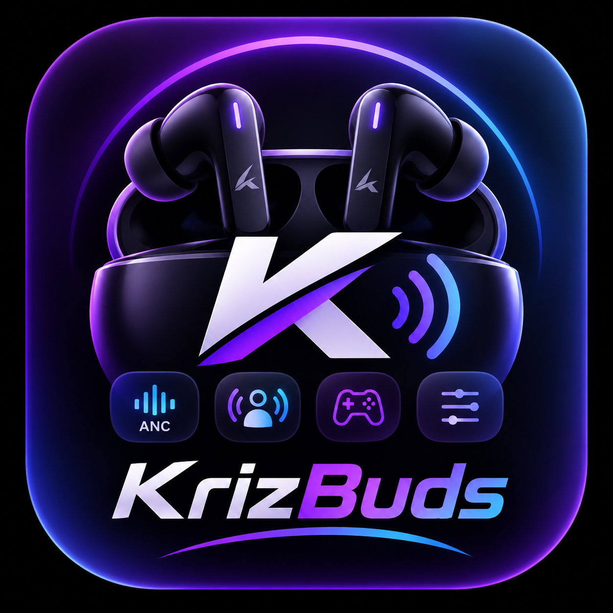

# KrizBuds Control

<div align="center">
  
  <h3>Direct Hardware Audio Manager for Wireless Earbuds</h3>
  <p>Real-time Bluetooth BLE/SPP protocol control, Active Noise Cancellation, BEAST™ low-latency mode, hardware DSP equalizers, and live battery telemetry.</p>

  <p>
    
    
    
    
    
    
  </p>
</div>

---

## 🎧 Overview

**KrizBuds Control** is a companion application designed for modern wireless earbuds and Bluetooth audio devices (including Airoha AB1562/AB155x, Bluetrum, and Bestechnic chipsets). 

Unlike standard manufacturer companion utilities that require cloud accounts and surveillance, **KrizBuds Control** communicates **directly with earbud hardware** via native RFCOMM Serial Port Profile (SPP) data channels and Bluetooth Low Energy (BLE) GATT attributes. No login, no third-party telemetry, and zero latency.

---

## ✨ Features

### 🔇 Active Noise Cancellation (ANC) & Ambient Modes
* **Three Acoustic Profiles**: Instantly toggle between **Normal (Passive)**, **Active Noise Cancellation (ANC)**, and **SpeakThrough (Ambient)**.
* **ANC Intensity Depth Dropdown**:
  * **Level 1 (Mild)** — Optimized for quiet offices and soft fan hums.
  * **Level 2 (Balanced)** — Tuned for daily commutes and ambient chatter (`+1.0 dB` gain).
  * **Level 3 (Max Deep)** — Deep isolation for flights, transit, and noisy environments (`+3.0 dB` gain).
* **Locked Mode Retention**: Mode state stays active without dropping back to passive mode upon packet ACK.

### ⚡ BEAST™ Mode (Ultra-Low Latency)
* Reduces audio transmission latency down to **~40–50ms**.
* Eliminates audio-visual delay for competitive gaming, fast-paced media, and live video streaming.
* Dispatches direct vendor protocol commands across Airoha RACE (`CmdId 0x1101`) and Bestechnic (`CmdId 0x6308`) channels.

### 🔋 Live Battery & Charging Telemetry
* Individual real-time percentage indicators for **Left Earbud**, **Right Earbud**, and the **Charging Case**.
* Live charging indicators (`⚡ Charging`) with dynamic color states based on power levels.
* Hybrid polling combining OS intent broadcasts, GATT Battery Service (`0x180F`), and reflection-based device reads.

### 🎚️ Hardware DSP Equalizer Presets
* Directly triggers hardware-level DSP sound curves on the earbud's internal digital signal processor:
  * **Signature**: Balanced default acoustic tuning.
  * **Bass Boost**: Enhanced low-end punch for electronic and hip-hop.
  * **Balanced**: Neutral frequency response for acoustic listening.
  * **Pop**: Vocal-forward frequency curve.
  * **Rock**: Elevated highs and driving mid-bass.
  * **Club**: Wide soundstage and dynamic punch.

### ☁️ Over-The-Air (OTA) Firmware Downloader
* Direct connection to cloud hearable firmware endpoints (`ota.hearables-cloud.com`).
* Downloads genuine device updates directly with real-time byte progress tracking.

### 🔍 Real-time Diagnostics Log Drawer
* Expandable in-app terminal displaying real-time BLE GATT events, SPP byte exchanges, and chipset ACK responses for transparency and troubleshooting.

### 🎨 Modern Soothing Design System
* Built exclusively with **Jetpack Compose** and **Material Design 3**.
* **Zero harsh red**: Calming cyan, sky blue, teal, slate, emerald, and electric indigo palette.
* **Theme Switcher**: Instant switching between Dark Mode and Light Mode.
* **Typography**: Bundled with **Plus Jakarta Sans** for clean, legible readability.

---

## 🛠️ Architecture & Tech Stack

```
com.krizbuds.control / com.example
 ├── BluetoothEarbudsManager.kt # Core Bluetooth state machine (SPP, BLE, Airoha, Bluetrum, BES)
 ├── EarbudModels.kt            # Device prefix detection (KrizBuds, Wireless, Audio, Buds, TWS, etc.)
 ├── EqualizerPreset.kt         # DSP Equalizer enum identifiers
 ├── FirmwareDownloader.kt      # HTTP OTA binary downloader
 ├── MainActivity.kt            # Lifecycle, permissions, edge-to-edge windowing
 └── ui/
      ├── KrizBudsApp.kt        # Main Compose screen & top bar navigation
      ├── components/
      │    ├── BatteryCard.kt         # Segmented battery telemetry cards
      │    ├── BeastModeCard.kt       # Low-latency toggle card
      │    ├── DeviceSelectionCard.kt # Radar discovery list & device pairing
      │    ├── EqualizerCard.kt       # Hardware DSP preset switcher
      │    ├── FirmwareCard.kt        # OTA updater & expandable BLE log drawer
      │    ├── HeroConnectedCard.kt   # 3D render banner with status badge
      │    └── NoiseControlCard.kt    # ANC mode selector & intensity dropdown
      └── theme/
           ├── Color.kt               # Soothing Cyan/Teal/Slate color tokens
           ├── Theme.kt               # M3 Light and Dark color schemes
           └── Type.kt                # Plus Jakarta Sans typography system
```

---

## 🔒 Permissions & Security

KrizBuds Control adheres strictly to the principle of least privilege:

| Permission | Purpose |
|:---|:---|
| `BLUETOOTH_CONNECT` | Connect to paired earbuds and transmit audio mode packets |
| `BLUETOOTH_SCAN` (`neverForLocation`) | Discover nearby earbuds via BLE advertising packets |
| `ACCESS_FINE_LOCATION` | Required on Android 11 and lower for Bluetooth LE discovery |
| `INTERNET` | Fetch genuine over-the-air firmware updates from official servers |

*Zero user tracking, no accounts, and no background analytics.*

---

## 🚀 Building & Running

### Prerequisites
- Android Studio Hedgehog (2023.1.1) or newer
- JDK 17 or JDK 21
- Android device running Android 7.0 (API 24) or higher with Bluetooth enabled

### Build Debug APK
```bash
# Compile and run unit tests
gradle :app:testDebugUnitTest

# Build debug APK
gradle :app:assembleDebug
```
The output APK will be generated at:
`app/build/outputs/apk/debug/app-debug.apk`

---

## 📄 License
This project is open-source and intended for hardware companion control. All device protocol trademarks belong to their respective owners.
